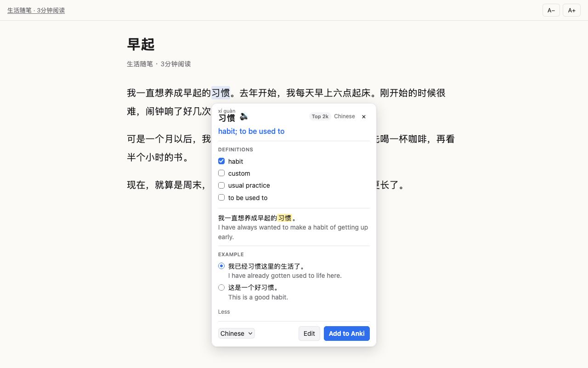

<h1 align="center">Language Companion</h1>

<p align="center">
  Learn Japanese, Korean and Chinese from the web you already read.<br>
  Look up any word in context and save it to Anki in one click.
</p>

<p align="center">
  <a href="https://github.com/mirodn/language-companion/actions/workflows/ci.yml"></a>
  
  <a href="LICENSE"></a>
</p>

<p align="center">
  
</p>

Language Companion is a Firefox extension for learners who read real content: news, blogs, novels, YouTube. Select a word you don't know, see what it means *in that sentence*, and send it to Anki as a flashcard with the sentence, reading, audio and a link back to where you found it.

**Read → look up → understand → save → review later.** You never leave the page.

## Contents

- [Features](#features)
- [Language support](#language-support)
- [Installation](#installation)
- [Connecting Anki](#connecting-anki)
- [Usage](#usage)
- [Privacy](#privacy)
- [Development](#development)
- [Contributing](#contributing)
- [Acknowledgements](#acknowledgements)
- [License](#license)

## Features

**Understand a word**

- A small card next to the word: translation, reading and the main definition at a glance. **More** shows all definitions, the kanji and example sentences
- Furigana for Japanese, pinyin for Chinese, audio or text-to-speech for everything
- Conjugated words lead to their dictionary form: 食べました → 食べる, 갔어요 → 가다, 학교에 → 학교
- JLPT level or word frequency ("Top 2k") shows what is worth learning first
- The sentence translation stays hidden until you ask for it, so you try the sentence yourself first

**Read and watch**

- **Reader:** opens any article in a calm view where every word is clickable. This helps most with Japanese and Chinese, which have no spaces between words
- **Quick peek:** hold <kbd>Shift</kbd> over a word in the reader or in YouTube subtitles to see its reading and meaning
- **YouTube:** click a word in the subtitles. The video pauses, and the subtitle line becomes the card's sentence, with a link back to that moment in the video

**Remember**

- One click (or <kbd>Enter</kbd>) adds the note to Anki, with duplicate detection and a deck per language
- **Works while Anki is closed:** notes wait and are added as soon as Anki opens
- Uses a ready-made note type, or your own one with field mapping
- A stats page shows words per week, your streak and where you learn from

## Language support

The language is recognised from the writing system, so there is nothing to switch. Kana means Japanese and Hangul means Korean. Text with only kanji or hanzi goes to whichever of Japanese and Chinese you learn. If you learn both, the card shows a Japanese | Chinese switch.

|  | Japanese | Korean | Chinese |
| --- | --- | --- | --- |
| Reading | Furigana | Hangul is phonetic | Pinyin with tone marks |
| Dictionary form | 食べました → 食べる | 갔어요 → 가다, 학교에 → 학교 | not needed |
| Definitions | Jisho | Wiktionary | CC-CEDICT, built in |
| Frequency badge | JLPT N5–N1 | Top 1k–20k | Top 1k–20k |
| Extras | Kanji breakdown (KANJIDIC2, built in) | | Simplified and traditional, every reading of 行 |
| Example sentences | Tatoeba | Tatoeba | Tatoeba |

Translations come from MyMemory (free, no account), DeepL (your API key) or LibreTranslate (your own server). Japanese is the default; add Korean or Chinese in the settings.

<p align="center">
  
  
</p>

## Installation

### From Firefox Add-ons

The extension is currently in review at addons.mozilla.org. The link will be here once it is approved.

### From source

Requirements: Firefox 140 or newer and Node.js 18 or newer.

```sh
git clone https://github.com/mirodn/language-companion.git
cd language-companion
npm install
npm start
```

`npm start` opens a separate Firefox profile with the extension loaded. To use it in your own profile, open `about:debugging#/runtime/this-firefox`, click **Load Temporary Add-on…** and pick `manifest.json`. Firefox removes temporary add-ons when it restarts.

## Connecting Anki

Lookups work without Anki. To save words you need [Anki Desktop](https://apps.ankiweb.net/) with the free [AnkiConnect](https://ankiweb.net/shared/info/2055492159) add-on.

After installing, a **setup page** opens. It shows the exact AnkiConnect setting to copy, checks the connection, and creates a deck per language. You can open it again from the settings ("Run setup again").

<details>
<summary>Setting up AnkiConnect by hand</summary>

1. In Anki: **Tools → Add-ons → Get Add-ons…**, enter `2055492159`, restart Anki.
2. **Tools → Add-ons → AnkiConnect → Config**, and add the extension's address to `webCorsOriginList`:

   ```json
   "webCorsOriginList": [
       "http://localhost",
       "moz-extension://YOUR-INTERNAL-UUID"
   ]
   ```

   The setup page shows this line ready to copy. You can also find the UUID in `about:debugging#/runtime/this-firefox` next to the extension, as "Internal UUID". With `npm start` it is always `62507959-2455-4db3-851d-e4b7ccd8ed3b` (pinned in `web-ext-config.mjs`).
3. Save and restart Anki, then click **Test connection** in the extension settings.

Keep `webBindAddress` at `127.0.0.1` so only your own computer can reach Anki. If the connection still fails, check that the address is not under `ignoreOriginList`. AnkiConnect puts it there when you click **No** in its permission dialog.

</details>

### What goes on the card

The built-in "Language Companion" note type is created on first use. Its fields:

- Word
- Translation
- Definition (with the kanji breakdown)
- Pronunciation (furigana or pinyin)
- Audio
- Sentence (the word highlighted)
- SentenceTranslation
- Example
- Source (a link to the page or the moment in the video)
- Language

Notes are tagged with the language (`lc::ja`) and frequency (`lc::freq::jlpt-n5`, `lc::freq::top-2k`), and with `lc::youtube` or `lc::reader` depending on where you found the word. To use your own note type, map its fields in the settings.

## Usage

Select a word and click the small **文A** button that appears, or open an article in the reader (toolbar button → **Open in reader**) and click any word.

| Key | Action |
| --- | --- |
| <kbd>Alt</kbd>+<kbd>Shift</kbd>+<kbd>L</kbd> | Look up the selection (also: right-click → Look up) |
| <kbd>Alt</kbd>+<kbd>Shift</kbd>+<kbd>A</kbd> | Look up and add to Anki right away |
| <kbd>Shift</kbd> (hold) | Quick peek in the reader and YouTube subtitles |
| <kbd>Shift</kbd>+click | Select the phrase between two words (reader, YouTube) |
| <kbd>Enter</kbd> | Add to Anki |
| <kbd>M</kbd> | More or less: all definitions, kanji, examples |
| <kbd>T</kbd> | Show the sentence translation |
| <kbd>B</kbd> | Use the dictionary form instead |
| <kbd>P</kbd> | Play the pronunciation |
| <kbd>E</kbd> | Edit the fields |
| <kbd>Esc</kbd> | Close |

The two global shortcuts can be changed in `about:addons` → ⚙ → **Manage Extension Shortcuts**. In the settings you can choose how the card opens (button, right away, or only by shortcut), turn sources on or off, and disable the extension on single sites.

**YouTube:** turn on subtitles in the player (any track, including auto-generated ones) and click a word. The card works in fullscreen, and the video resumes when it closes.

## Privacy

There is no account, no analytics and no server of our own. Only the word you look up, and optionally its sentence, goes to the dictionary and translation services you turn on. The Chinese and kanji dictionaries and the frequency lists are built in and work offline. Settings, the lookup cache and your word history stay in Firefox. See [PRIVACY.md](PRIVACY.md) for each service and each permission.

## Development

```sh
npm start        # Firefox with the extension, reloads on changes
npm test         # unit tests, no browser needed
npm run lint     # web-ext lint
npm run build    # package into web-ext-artifacts/
```

The code is plain JavaScript with no build step and no runtime dependencies.

```
manifest.json
src/
  background/    message router, lookup and cache, AnkiConnect client, offline queue
    providers/   one file per translator, dictionary and example source
  content/       selection handling, the lookup card (shadow DOM), quick peek, YouTube
  reader/        reader page and the script that extracts the article
  shared/        messages, languages, settings and furigana, shared by all pages
  welcome/       first-run setup
  options/       settings page
  action/        toolbar popup
  stats/         stats page
  vendor/        Mozilla Readability
data/            CC-CEDICT, KANJIDIC2 and frequency lists, built by scripts/
scripts/         converts the upstream dictionaries into data/
test/            node:test unit tests with saved API responses in test/fixtures
store/           addons.mozilla.org listing text and screenshots (not packaged)
```

**How a lookup works:**

1. The content script finds the word and its sentence.
2. The background script decides the language from the script and your languages, then asks the translator and the dictionaries in parallel.
3. Results are cached locally.
4. The card renders in a closed shadow root, so page styles can't break it and it can't break the page.
5. **Add to Anki** builds the note in `background/anki.js` and sends it to AnkiConnect. If Anki is closed, the note waits in a local queue.

### Adding a dictionary or translator

Create `src/background/providers/<name>.js`:

```js
export default {
  id: "myprovider",
  name: "My Provider",
  kind: "dictionary", // "translate", "dictionary" or "examples"
  needsKey: false,
  supports: (src, tgt) => src === "ja",
  async lookup({ text, src, tgt }, settings, ctx) {
    // return { translation } or { reading, definitions, examples } or { examples }
  },
};
```

Register it in `providers/index.js`, add its host to `host_permissions` in `manifest.json`, and add a test with a saved response in `test/fixtures/`.

### Rebuilding the bundled data

The files in `data/` are generated from the upstream dictionaries and checked in:

```sh
node scripts/build-cedict.mjs      # CC-CEDICT → data/cedict/
node scripts/build-kanjidic.mjs    # KANJIDIC2 → data/kanjidic/
node scripts/build-frequency.mjs   # FrequencyWords → data/frequency/
```

## Contributing

Bug reports, ideas and pull requests are welcome. Please read [CONTRIBUTING.md](CONTRIBUTING.md) first. For anything bigger than a small fix, open an issue so we can talk about the approach before you write the code.

**Planned:** a word list in the reader for adding several words at once, playing the sentence aloud, and audio clips from YouTube on the card. See [CHANGELOG.md](CHANGELOG.md) for what changed in each version.

## Acknowledgements

Language Companion is built on the work of these projects:

- [Jisho](https://jisho.org/), Japanese dictionary
- [CC-CEDICT](https://cc-cedict.org/) by MDBG, Chinese dictionary, CC BY-SA 4.0 ([details](data/cedict/ATTRIBUTION.md))
- [KANJIDIC2](https://www.edrdg.org/wiki/index.php/KANJIDIC_Project) by EDRDG, kanji meanings, CC BY-SA 4.0 ([details](data/kanjidic/ATTRIBUTION.md))
- [FrequencyWords](https://github.com/hermitdave/FrequencyWords) by Hermit Dave, word frequency, CC BY-SA 4.0 ([details](data/frequency/ATTRIBUTION.md))
- [Wiktionary](https://en.wiktionary.org/), [Tatoeba](https://tatoeba.org/), [Free Dictionary API](https://dictionaryapi.dev/) and [MyMemory](https://mymemory.translated.net/)
- [Readability](https://github.com/mozilla/readability) by Mozilla, the reader's article extraction, Apache-2.0
- [AnkiConnect](https://ankiweb.net/shared/info/2055492159), which makes all the Anki parts possible

## License

The code is under the [MIT License](LICENSE). The bundled dictionary data is under CC BY-SA 4.0 and Readability under Apache-2.0, as listed above.
