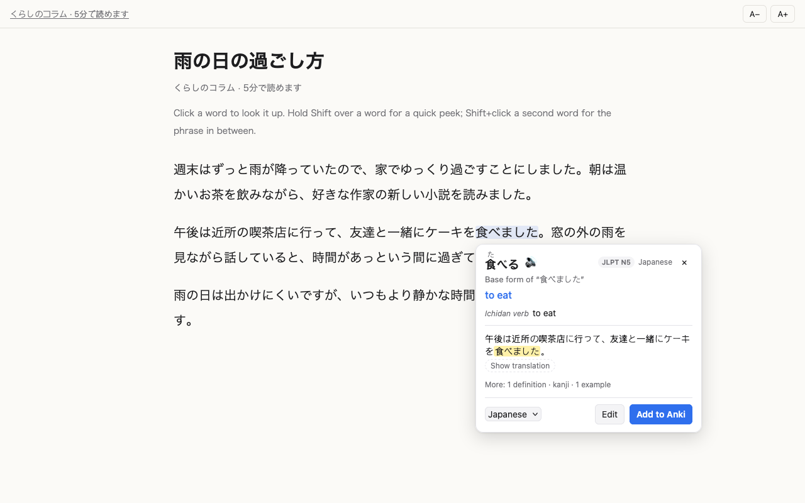
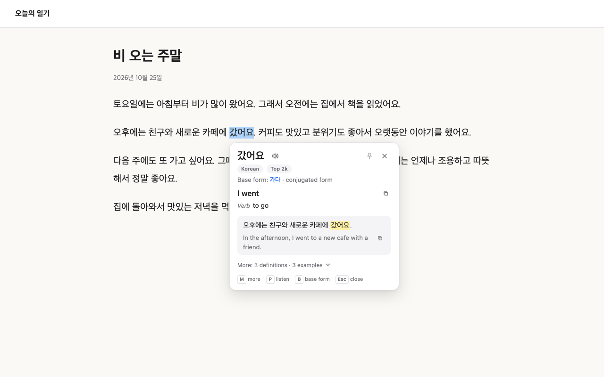

<h1 align="center">Language Companion</h1>

<p align="center">
  Understand Japanese and Korean on the web you already read.<br>
  Translate any word or sentence in context: on web pages, in manga and in YouTube subtitles.
</p>

<p align="center">
  <a href="https://github.com/mirodn/language-companion/actions/workflows/ci.yml"></a>
  
  <a href="LICENSE"></a>
</p>

<p align="center">
  
</p>

Language Companion is a Firefox extension for learners of Japanese and Korean who read real content: news, blogs, novels, manga, YouTube. Select a word or a sentence you don't understand and see what it means *right there*, with its reading, dictionary form and the translation of the sentence around it. You never leave the page.

If you use [Anki](https://apps.ankiweb.net/), you can also save words as flashcards in one click. That part is optional.

## Contents

- [Features](#features)
- [Language support](#language-support)
- [Installation](#installation)
- [Usage](#usage)
- [Saving words to Anki (optional)](#saving-words-to-anki-optional)
- [Privacy](#privacy)
- [Development](#development)
- [Contributing](#contributing)
- [Acknowledgements](#acknowledgements)
- [License](#license)

## Features

**Translate what you read**

- A small card next to your selection: translation, reading and the main definition at a glance, and the translation of the whole sentence. **More** shows all definitions, the kanji and example sentences
- Select the next word and the same card updates. Pin the card (or drag it anywhere) and it stays put and open while you read and turn pages
- Furigana for Japanese, audio or text-to-speech for everything
- Conjugated words lead to their dictionary form: 食べました → 食べる, 갔어요 → 가다, 학교에 → 학교
- JLPT level or word frequency ("Top 2k") shows what is worth learning first

**Read and watch**

- **Manga and webtoons:** on sites like Shonen Jump+, click a speech bubble and the card shows its text and translation. Click a word or drag across words to look them up, then go back to the bubble. It runs on your computer. Turn it on for a site in the toolbar menu
- **Reader:** opens any article in a calm view where every word is clickable. This helps most with Japanese, which has no spaces between words
- **Quick peek:** hold <kbd>Shift</kbd> over a word in the reader or in YouTube subtitles to see its reading and meaning
- **YouTube:** click a word in the subtitles. The video pauses, and the subtitle line becomes the card's sentence

**Optional: remember with Anki**

- One click (or <kbd>Enter</kbd>) adds the word to Anki, with the sentence, reading, audio and a link back to where you found it
- Duplicate detection, a deck per language, and notes wait while Anki is closed

## Language support

The language is recognised from the writing system, so there is nothing to switch: kana and kanji mean Japanese, Hangul means Korean.

|  | Japanese | Korean |
| --- | --- | --- |
| Reading | Furigana | Hangul is phonetic |
| Dictionary form | 食べました → 食べる | 갔어요 → 가다, 학교에 → 학교 |
| Definitions | Jisho | Wiktionary |
| Frequency badge | JLPT N5–N1 | Top 1k–20k |
| Extras | Kanji breakdown (KANJIDIC2, built in) | |
| Text in images | manga-ocr, trained on manga | PaddleOCR |
| Example sentences | Tatoeba | Tatoeba |

Translations come from MyMemory (free, no account), DeepL (your API key) or LibreTranslate (your own server). Japanese is the default; add Korean in the settings.

<p align="center">
  
</p>

## Installation

### From Firefox Add-ons

The extension is currently in review at addons.mozilla.org. The link will be here once it is approved.

### From source

Requirements: Firefox 140 or newer and Node.js 18 or newer.

```sh
git clone https://github.com/mirodn/language-companion.git
cd language-companion
npm install
npm start
```

`npm start` opens a separate Firefox profile with the extension loaded. To use it in your own profile, run `npm run build` and load the zip from `web-ext-artifacts/` in `about:debugging#/runtime/this-firefox` → **Load Temporary Add-on…**. Firefox removes temporary add-ons when it restarts.

## Usage

Select a word or a sentence and click the small **文A** button that appears. To open the card right away instead, choose "Open the card immediately" in the settings under Behavior. In the reader (toolbar button → **Open in reader**), just click any word.

| Key | Action |
| --- | --- |
| <kbd>Alt</kbd>+<kbd>Shift</kbd>+<kbd>L</kbd> | Look up the selection (also: right-click → Look up) |
| <kbd>Shift</kbd> (hold) | Quick peek in the reader and YouTube subtitles |
| <kbd>Shift</kbd>+click | Select the phrase between two words (reader, YouTube) |
| <kbd>M</kbd> | More or less: all definitions, kanji, examples |
| <kbd>T</kbd> | Show the sentence translation, if you chose to hide it |
| <kbd>B</kbd> | Look up the dictionary form instead |
| <kbd>Backspace</kbd> | Back to the speech bubble (manga) |
| <kbd>P</kbd> | Play the pronunciation |
| <kbd>Esc</kbd> | Close |

The global shortcut can be changed in `about:addons` → ⚙ → **Manage Extension Shortcuts**. In the settings you can choose how the card opens (button, right away, or only by shortcut), turn sources on or off, and disable the extension on single sites.

**Manga and webtoons:** Shonen Jump+ is on by default; for other sites, open the toolbar menu there and turn on "Read text in images". Firefox asks once for permission to access all websites, which it requires before an extension may capture the visible part of a tab. The first time, the text recognition models are downloaded (about 120 MB for Japanese, 20 MB for Korean), with the progress in the page's corner. After each page turn, the speech bubbles light up briefly; later they show an outline when you point at them. Click one and the card shows its text and translation. Click a word, drag across several, or Shift+click to extend, and the card shows that word, with ← (or <kbd>Backspace</kbd>) back to the bubble. Downloaded models and sites can be managed in the settings under "Text in images". Each bubble takes about a second to read; reading starts as soon as a page appears, so the next bubbles are usually ready.

**YouTube:** turn on subtitles in the player (any track, including auto-generated ones) and click a word. The card works in fullscreen, and the video resumes when it closes.

## Saving words to Anki (optional)

Turn on **Save words to Anki** in the settings or on the setup page. You need [Anki Desktop](https://apps.ankiweb.net/) with the free [AnkiConnect](https://ankiweb.net/shared/info/2055492159) add-on. The setup page shows the exact AnkiConnect setting to copy, checks the connection, and creates a deck per language. You can open it again from the settings ("Run setup again").

With Anki on, the card gets a deck menu, an **Edit** button and **Add to Anki**:

| Key | Action |
| --- | --- |
| <kbd>Alt</kbd>+<kbd>Shift</kbd>+<kbd>A</kbd> | Look up and add to Anki right away |
| <kbd>Enter</kbd> | Add to Anki |
| <kbd>E</kbd> | Edit the fields |

<details>
<summary>Setting up AnkiConnect by hand</summary>

1. In Anki: **Tools → Add-ons → Get Add-ons…**, enter `2055492159`, restart Anki.
2. **Tools → Add-ons → AnkiConnect → Config**, and add the extension's address to `webCorsOriginList`:

   ```json
   "webCorsOriginList": [
       "http://localhost",
       "moz-extension://YOUR-INTERNAL-UUID"
   ]
   ```

   The setup page shows this line ready to copy. You can also find the UUID in `about:debugging#/runtime/this-firefox` next to the extension, as "Internal UUID". With `npm start` it is always `62507959-2455-4db3-851d-e4b7ccd8ed3b` (pinned in `web-ext-config.mjs`).
3. Save and restart Anki, then click **Test connection** in the extension settings.

Keep `webBindAddress` at `127.0.0.1` so only your own computer can reach Anki. If the connection still fails, check that the address is not under `ignoreOriginList`. AnkiConnect puts it there when you click **No** in its permission dialog.

</details>

### What goes on the card

The built-in "Language Companion" note type is created on first use. Its fields: Word, Translation, Definition (with the kanji breakdown), Pronunciation (furigana), Audio, Sentence (the word highlighted), SentenceTranslation, Example, Source (a link to the page or the moment in the video) and Language.

Notes are tagged with the language (`lc::ja`) and frequency (`lc::freq::jlpt-n5`, `lc::freq::top-2k`), and with `lc::youtube`, `lc::reader` or `lc::manga` depending on where you found the word. To use your own note type, map its fields in the settings. A stats page shows words per week, your streak and where you learn from.

## Privacy

There is no account, no analytics and no server of our own. Only what you look up, and optionally its sentence, goes to the dictionary and translation services you turn on. Text in images is recognised on your computer; screenshots are never saved or sent. The kanji dictionary and the frequency lists are built in and work offline. Settings, the lookup cache and your word history stay in Firefox. See [PRIVACY.md](PRIVACY.md) for each service and each permission, and [SECURITY.md](SECURITY.md) for how the extension guards against hostile pages and how to report a vulnerability.

## Development

```sh
npm start        # Firefox with the extension, reloads on changes
npm test         # unit tests, no browser needed
npm run lint     # web-ext lint
npm run build    # package into web-ext-artifacts/
npm run lab      # test page for text recognition in images
```

The code is plain JavaScript with no build step. The only runtime dependency, ONNX Runtime Web, is copied from `node_modules` into `src/vendor/` before `start`, `lint` and `build`.

```
manifest.json
src/
  background/    message router, lookup and cache, AnkiConnect client, offline queue, text in images
    providers/   one file per translator, dictionary and example source
  content/       selection handling, the lookup card (shadow DOM), quick peek, YouTube, manga
  ocr/           text recognition: PaddleOCR (finding text, Korean) and manga-ocr (Japanese)
  reader/        reader page and the script that extracts the article
  shared/        messages, languages, settings and furigana, shared by all pages
  welcome/       first-run setup
  options/       settings page
  action/        toolbar popup
  stats/         stats page
  lab/           text recognition test page (development only, not packaged)
  vendor/        Mozilla Readability, ONNX Runtime Web
data/            KANJIDIC2 and frequency lists, built by scripts/
scripts/         converts the upstream dictionaries into data/, copies ONNX Runtime
test/            node:test unit tests with saved API responses in test/fixtures
store/           addons.mozilla.org listing text and screenshots (not packaged)
```

**How a lookup works:**

1. The content script finds the selection and its sentence.
2. The background script decides the language from the writing system, then asks the translator and the dictionaries in parallel.
3. Results are cached locally.
4. The card renders in a closed shadow root, so page styles can't break it and it can't break the page.
5. With Anki on, **Add to Anki** builds the note in `background/anki.js` and sends it to AnkiConnect. If Anki is closed, the note waits in a local queue.

### Adding a dictionary or translator

Create `src/background/providers/<name>.js`:

```js
export default {
  id: "myprovider",
  name: "My Provider",
  kind: "dictionary", // "translate", "dictionary" or "examples"
  needsKey: false,
  supports: (src, tgt) => src === "ja",
  async lookup({ text, src, tgt }, settings, ctx) {
    // return { translation } or { reading, definitions, examples } or { examples }
  },
};
```

Register it in `providers/index.js`, add its host to `host_permissions` in `manifest.json`, and add a test with a saved response in `test/fixtures/`.

### Rebuilding the bundled data

The files in `data/` are generated from the upstream dictionaries and checked in:

```sh
node scripts/build-kanjidic.mjs    # KANJIDIC2 → data/kanjidic/
node scripts/build-frequency.mjs   # FrequencyWords → data/frequency/
```

## Contributing

Bug reports, ideas and pull requests are welcome. Please read [CONTRIBUTING.md](CONTRIBUTING.md) first. For anything bigger than a small fix, open an issue so we can talk about the approach before you write the code.

**Planned:** playing the sentence aloud, and a word list in the reader. See [CHANGELOG.md](CHANGELOG.md) for what changed in each version.

## Acknowledgements

Language Companion is built on the work of these projects:

- [Jisho](https://jisho.org/), Japanese dictionary
- [KANJIDIC2](https://www.edrdg.org/wiki/index.php/KANJIDIC_Project) by EDRDG, kanji meanings, CC BY-SA 4.0 ([details](data/kanjidic/ATTRIBUTION.md))
- [FrequencyWords](https://github.com/hermitdave/FrequencyWords) by Hermit Dave, word frequency, CC BY-SA 4.0 ([details](data/frequency/ATTRIBUTION.md))
- [Wiktionary](https://en.wiktionary.org/), [Tatoeba](https://tatoeba.org/), [Free Dictionary API](https://dictionaryapi.dev/) and [MyMemory](https://mymemory.translated.net/)
- [manga-ocr](https://github.com/kha-white/manga-ocr) by Maciej Budyś, reading Japanese manga, Apache-2.0
- [PaddleOCR](https://github.com/PaddlePaddle/PaddleOCR) by PaddlePaddle, finding text in images and reading Korean, Apache-2.0
- [ONNX Runtime Web](https://github.com/microsoft/onnxruntime) by Microsoft, which runs these models in the browser, MIT
- [Readability](https://github.com/mozilla/readability) by Mozilla, the reader's article extraction, Apache-2.0
- [AnkiConnect](https://ankiweb.net/shared/info/2055492159), which makes the Anki parts possible

## License

The code is under the [MIT License](LICENSE). The bundled dictionary data is under CC BY-SA 4.0, Readability under Apache-2.0 and ONNX Runtime Web under MIT, as listed above.
